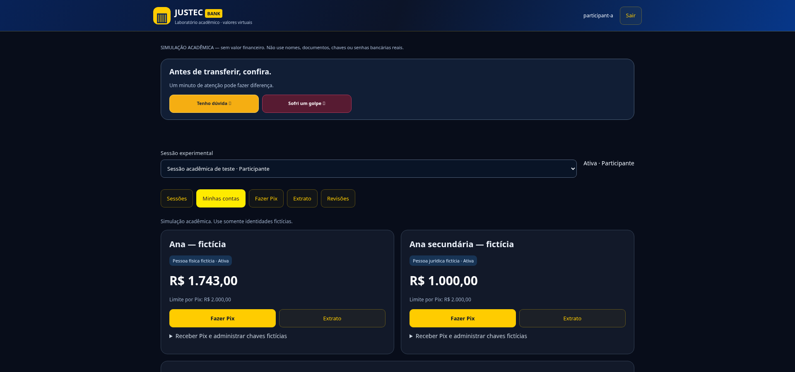

# Resumo executivo

A atualização transforma a capacidade de experimentação do JUSTEC: além da demonstração educativa já existente, o projeto passa a oferecer um laboratório com usuários autenticados, contas virtuais persistentes, transferências internas bilaterais e instrumentos de pesquisa. A operação deixa de depender exclusivamente do estado do navegador e passa a ser validada e registrada no servidor.

A principal contribuição técnica é unir três elementos: uma jornada compreensível de transferência, integridade de débito e crédito e prevenção experimental explicável. A principal contribuição metodológica é permitir observar tanto acertos quanto erros do Guard, preservando a decisão original e separando o gabarito experimental dos dados disponíveis ao algoritmo.

O trabalho foi implementado e testado localmente. Foram aprovados 147 testes automatizados de domínio, HTTP e operação; nove suítes de regressão do protótipo; e testes do laboratório no Chromium em sete larguras. Esses resultados demonstram comportamentos de software nas condições ensaiadas, não eficácia comprovada contra fraudes reais.

A versão anterior foi destinada à manutenção na branch main/Vercel; a nova fica na branch laboratorio-multiusuario. A hospedagem persistente foi preparada para Render, mas sua ativação exige acesso à conta do titular, confirmação do plano com volume e validação posterior. Não há nova URL pública confirmada neste documento.

# Origem, objetivo e limites desta atualização

## Documentos de origem

O desenvolvimento considerou o pedido mestre fornecido pelo responsável pelo projeto, a Estratégia Integrada de Prevenção a Fraudes no Pix e a Proposta de Laboratório Multiusuário. Os dois documentos conceituais eram propostas: a autorização de execução veio do pedido direto, não de uma aprovação científica presumida.

O objetivo foi construir um ambiente de experimentação coerente, mantendo a identidade visual, o acesso à educação, a jornada Pix e os conteúdos preventivos anteriores. Não houve migração automática do saldo ilustrativo da demonstração para contas de participantes.

## Escopo efetivamente entregue

| Área | Entrega |
|---|---|
| Acesso | Cadastro com pseudônimo, login, sessão autenticada, logout e permissões no servidor. |
| Organização | Sessões acadêmicas isoladas, participantes, pesquisadores, administradores e convites. |
| Contas | Múltiplas contas virtuais, perfis públicos, limites e chaves sintéticas. |
| Transferência | Débito e crédito atômicos, comprovante, extratos bilaterais e idempotência. |
| Prevenção | Evidências, contexto, pausa, ações explicadas e revisão posterior. |
| Pesquisa | Cenários, condições, execuções repetíveis, restauração, métricas e exportações. |
| Operação | Migrações, backup, bootstrap administrativo e configuração de hospedagem. |
| Preservação | Protótipo original e seus módulos financeiros e de risco mantidos. |

Ficam fora do escopo dinheiro verdadeiro, DICT, SPI, conexão com bancos, empréstimos, investimentos e identidade bancária real. QR Code e Pix Copia e Cola não foram implementados como modalidades funcionais. O laboratório usa somente identidades e valores sintéticos.

# Comparação entre o estado anterior e o atual

| Aspecto | Demonstração anterior | Novo laboratório |
|---|---|---|
| Autoridade do estado | JavaScript no navegador. | Serviço autenticado e banco no servidor. |
| Duração dos dados | Reiniciados com recarga da demonstração. | Preservados em arquivo privado persistente. |
| Destinatários | Catálogo ilustrativo. | Contas e chaves criadas na sessão. |
| Transferência | Débito ilustrativo na origem. | Débito na origem e crédito no destino, inseparáveis. |
| Usuários | Sem autenticação de participantes. | Acessos distintos e titularidade verificada. |
| Repetição de pesquisa | Cenário local. | Estado-base, titulares e política identificados. |
| Risco | Política demonstrativa existente. | Adaptação no servidor com condições controladas. |
| Revisão | Demonstração educativa. | Revisão autorizada e persistente sem apagar o original. |

As duas experiências coexistem. Isso permite apresentar a orientação ao consumidor sem exigir cadastro e usar o laboratório quando a atividade requer continuidade e interação entre participantes.

# Arquitetura implementada

## Separação de responsabilidades

O navegador apresenta formulários e resultados; não determina saldo final, privilégio, validade da chave ou aprovação definitiva. A API autentica, verifica permissões e coordena serviços. A camada de domínio aplica invariantes. O SQLite registra os fatos em transações.

O caminho lógico é: interface do participante → API autenticada → validação de domínio e Guard → transação no livro-razão → comprovante e extratos. A pesquisa consulta registros autorizados e confronta resultados com gabaritos mantidos separadamente.

## Tecnologias e dependências

O servidor utiliza Node.js 24, HTTP nativo, criptografia nativa e node:sqlite. Não foram adicionados frameworks de execução. Playwright aparece somente como dependência de desenvolvimento para testes de navegador. O armazenamento é SQLite em modo WAL, com chaves estrangeiras e sincronização configuradas.

O runtime Tailwind já utilizado pelo projeto foi fixado localmente com versão e licença. A interface autenticada utiliza scripts e estilos locais, com política de segurança de conteúdo. Recursos CSS e fontes externos ainda existentes na demonstração não foram apresentados como validação de serviços externos.

## Organização dos arquivos

| Arquivo ou diretório | Responsabilidade |
|---|---|
| server/db.cjs e migrations/ | Banco, transações, migrações e integridade estrutural. |
| server/security.cjs | Validação, derivação de senha, tokens e autenticação. |
| server/http.cjs e index.cjs | Rotas, proteções HTTP, arquivos públicos e inicialização. |
| server/lab.cjs | Contas, chaves, transferências, extratos e revisões. |
| server/guard.cjs e profiles.cjs | Política experimental e perfis públicos. |
| server/research.cjs | Cenários, execuções, snapshots, métricas e exportações. |
| server/bootstrap.cjs e backup.cjs | Primeiro administrador e cópia consistente do banco. |
| laboratorio/ | Interface nova para participante e pesquisador. |
| tests/lab-*.cjs | Testes de domínio, API, operação e navegador. |
| render.yaml e deploy/README.md | Preparação de hospedagem persistente. |
| Documentação/Apresentacao/ | Documentos destinados à apresentação e proposta. |

# Funcionamento das partes novas

## Acesso e autenticação

O participante cadastra um pseudônimo sintético e uma senha exclusiva do laboratório. A senha é derivada por scrypt com salt; não é gravada em texto aberto. Após login, o navegador recebe cookie HttpOnly, SameSite Strict, com duração de oito horas. Em origem HTTPS, recebe também Secure.

Ações de alteração exigem origem esperada, JSON e token CSRF. O servidor limita tentativas e tamanho de requisições. O usuário não escolhe papel administrativo no cadastro. O primeiro administrador é criado por comando local com senha fornecida pelo operador, sem credencial padrão.

## Sessões, convites e permissões

Uma sessão acadêmica reúne participantes, políticas e dados de um experimento. Membros de outra sessão não podem consultar ou movimentar suas contas. O administrador gera convite de uso único e define o papel. O convite expira; a aceitação é registrada.

O participante usa suas contas e consulta seus registros. O pesquisador acessa instrumentos de análise da sessão autorizada. O administrador gere participantes e configuração. Mesmo um pesquisador não pode transferir em nome de outro titular. O último administrador não pode ser removido de forma que a sessão fique sem responsável.

## Contas e chaves

Cada participante cria contas conforme o limite da sessão e escolhe perfis públicos, como pessoa física fictícia, pessoa jurídica fictícia, conta nova ou com histórico. É possível configurar outros perfis. Essas descrições não significam que uma pessoa ou conta seja fraudulenta.

As chaves são identificadores gerados para a simulação, em domínio reservado .invalid. São resolvidas apenas no escopo autorizado. Criar, rotacionar e desativar chave produz registro auditável. Uma consulta não revela o saldo privado do destinatário.

A alocação inicial é definida pela sessão e aparece no livro-razão separada de transferências. O participante não pode editar saldo pelo navegador. Ajustes administrativos são operações identificadas, não substituições silenciosas de valores.

## Integridade da transferência

Dinheiro virtual é representado por centavos inteiros. Valores não numéricos, não finitos, fracionários em centavos, negativos ou fora do contrato são recusados. Titularidade, sessão, chave, situação operacional, limite e saldo são checados novamente no momento de confirmar.

A autorização abre uma transação SQLite: registra a transferência, uma partida negativa na origem e uma positiva no destino. Se qualquer etapa falhar, todas são revertidas. Não existe situação válida de sucesso com débito sem crédito. O saldo é obtido do livro-razão, não de um número enviado pelo cliente.

A idempotência associa a confirmação à operação. Repetir o envio devolve o mesmo resultado sem descontar novamente. Operações concorrentes disputam escrita e reavaliam saldo sob bloqueio; uma interface lenta ou dois cliques não autorizam saldo negativo.

Exemplo didático: Ana possui R$ 2.000,00 e Robson R$ 1.000,00. Ao enviar R$ 250,00, Ana passa a R$ 1.750,00 e Robson a R$ 1.250,00. A soma permanece R$ 3.000,00. Esses valores ilustram o contrato, não uma conta real.

## Jornada e pausa preventiva

A jornada preserva a ordem: iniciar, identificar destinatário, informar valor, conferir, passar pela prevenção cabível, autorizar e receber resultado. Perguntas contextuais podem entrar entre conferência e pausa. Uma interrupção fundamentada encerra antes do débito.

A pausa é controlada pelo servidor. Terminar a barra não envia dinheiro nem avança automaticamente. O usuário pode reconsiderar, verificar ou continuar para o código demonstrativo 0000. Esse código não substitui o login, e nenhum usuário deve inserir senha bancária real.

Rascunhos têm prazo de validade. Alterações de política, chave, saldo, limite ou restrição podem invalidar a autorização posterior. Nesses casos, o sistema retorna erro ou interrupção e não um comprovante de sucesso.

## Guard e explicabilidade

O Guard combina evidências observáveis e respostas efetivamente fornecidas. Indicadores incluem destinatário novo, valor atípico diante de histórico suficiente, repetição e alterações, além de contexto de urgência, identidade, adiantamento e instruções para ignorar alertas. Ausência de informação não é prova de segurança.

Cada avaliação conserva indicadores, justificativas, pontuação, ação e versão das regras. As ações possíveis são permitir, solicitar verificação, considerar inconclusivo ou interromper. Pontuação não comprova fraude. Uma interrupção contextual não implica bloquear permanentemente o recebedor.

O módulo experimental original em js/guard continua separado. A adaptação do laboratório não foi apresentada como certificação ou integração bancária real. Regras do protótipo original permanecem preservadas; políticas da sessão de pesquisa podem ser configuradas e versionadas.

## Revisão e preservação do histórico

O participante solicita revisão; membro autorizado registra decisão posterior. A avaliação original continua registrada. Uma liberação cria nova conferência vinculada e não ignora saldo, titularidade, sessão ou restrição operacional. A revisão é uma camada de responsabilidade humana, não uma forma de apagar erros do algoritmo.

Autorrelato opcional permite registrar percepção de compreensão e intenção. É dado subjetivo e imutável; não condiciona o Pix e não equivale a instrumento validado de avaliação psicológica ou de eficácia.

## Cenários e pesquisa

O pesquisador cria cenário com contas, histórico sintético, operações e verdade experimental. A verdade é armazenada separadamente e não é passada ao Guard. Respostas previstas no roteiro tampouco são usadas antecipadamente para ativar intervenção: contexto é solicitado explicitamente ou decorre de dados realmente fornecidos.

Cada execução cria novo ambiente e identifica base, política e titulares por hashes. Repetir conserva essas condições, inclusive quando a sessão-mãe foi posteriormente reconfigurada. Restauração cria uma nova sessão, preservando resultados anteriores, sem repetir débitos antigos.

Cinco condições podem ser comparadas: sem intervenção adicional, educação, contexto, comportamento e integrada. Como a educação da página inicial permanece disponível, a condição sem intervenção não significa ausência absoluta de exposição educativa.

# Métricas, exportação e interpretação

A matriz considera positivo quando a operação é interrompida. Conclusão é resultado negativo para a intervenção. O pesquisador confronta esse resultado com o gabarito do cenário.

| Resultado | Significado experimental |
|---|---|
| Verdadeiro positivo | Fraude simulada interrompida. |
| Falso positivo | Operação legítima simulada interrompida. |
| Verdadeiro negativo | Operação legítima simulada concluída. |
| Falso negativo | Fraude simulada concluída. |

Pendências e cancelamentos não são silenciosamente contados como acerto. Taxas têm denominadores; ausência de amostra aparece como sem dados. A revisão manual não converte retroativamente um falso positivo em acerto original. Exportações JSON e CSV incluem dados autorizados, sem senhas, cookies, hashes de autenticação ou convites. Texto em CSV é protegido contra interpretação como fórmula.

# Evidência de validação

| Conjunto executado | Resultado e alcance |
|---|---|
| npm test | 147 aprovados; zero falhas, cancelamentos e ignorados. Inclui 107 anteriores e 40 novos. |
| npm run test:legacy | Nove suítes anteriores aprovadas: saldo, extrato, Pix, sequência, layout, conteúdos e atalhos. |
| npm run test:browser | Laboratório aprovado em 320, 375, 390, 768, 1024, 1366 e 1920 px. |
| Concorrência | Dois workers com conexões SQLite independentes e autorizações HTTP simultâneas. |
| Falha de escrita | Exceção injetada entre partidas; rollback integral observado. |
| Persistência | Reabertura de arquivo, novo login e reinício HTTP preservaram dados. |
| Operação | Bootstrap, migração concorrente e backup consistente exercitados. |

Os testes de navegador verificaram múltiplos participantes, múltiplas contas, transferências bilaterais, recarga, papéis, falso positivo e exportação. A pausa inicial de cinco segundos foi executada; repetições posteriores usaram duração reduzida configurada. Links externos e compartilhamento do protótipo são interceptados nos testes, sem envio real nem comprovação de disponibilidade institucional.

Ensaios intermediários detectaram classe de seletor duplicada e problemas nos helpers de teste, corrigidos antes dos resultados finais. Testes de sucesso não substituem auditoria independente. Não foram executados estudo de eficácia com pessoas, teste de carga em produção, avaliação formal com leitor de tela, aparelhos físicos ou certificação jurídica.

# Registro visual da implementação

{width=16cm}

A imagem registra a área persistente e o acesso à educação antes do Pix. Não é captura de uma publicação externa. A navegação de pesquisa permanece condicionada ao papel autenticado.

# Versionamento e hospedagem

O commit anterior 837cb414ad27a149c9e0c57004f75af340ba9aec identifica a demonstração estática. A organização proposta e preparada preserva main e a cópia versao-estatica-vercel; a tag prototipo-estatico-2026-10-22 marca esse ponto. A nova implementação fica em laboratorio-multiusuario. O histórico anterior permanece disponível.

A produção Vercel deve continuar apontando para main. Não foi possível autenticar no painel Vercel nem certificar sua configuração; a consulta pública ao domínio foi recusada pela rede do ambiente. Isso não permite concluir que o site está fora do ar. Não se enviou o backend à produção estática.

O laboratório usa SQLite e precisa de volume persistente. A Vercel exigiria adaptação para banco externo e outro modelo de execução; essa adaptação não está implementada. Foi preparado render.yaml com Node 24, uma instância, health check e volume privado. O plano indicado e o disco podem gerar cobrança. O titular deve confirmar as condições no Render e concluir a associação da conta/repositório. Até validar a URL, a implantação permanece pendente.

# Uso e demonstração acadêmica

Para executar, instalar Node 24, seguir o bootstrap seguro do README e iniciar com npm start. Abrir http://127.0.0.1:3000/laboratorio/. Live Server atende somente ao protótipo estático; não oferece a API do laboratório.

Sugestão de apresentação: mostrar educação inicial; entrar como participante; criar duas contas; receber a chave de outro usuário; transferir valor fictício; conferir ambos os extratos; recarregar; demonstrar interrupção contextual; abrir a revisão; e, como pesquisador, comparar cenários com rótulos opostos. Encerrar expondo falso positivo e falso negativo, em vez de prometer detecção universal.

Para demonstração remota, concluir antes implantação, administrador, backup e teste de persistência após reinício. Não compartilhar credenciais administrativas com a plateia. Preparar contas de apresentação sintéticas e acesso de participante por convite.

# Limitações e continuidade recomendada

O produto está no estágio de laboratório acadêmico funcional, não de infraestrutura financeira. SQLite de instância única serve a ensaios pequenos; não demonstra escalabilidade bancária. Triggers protegem a aplicação contra edição histórica, mas não impedem um administrador do sistema operacional de manipular arquivos.

Prioridade imediata: ativar hospedagem persistente, validar TLS/Host/origem, executar roteiro em nuvem, manter backup privado externo e ensaiar recuperação. Depois, realizar revisão independente de segurança, testes de acessibilidade e usabilidade, carga, monitoramento, revisão de permissões e política de retenção.

Para parceria empresarial, recomendar piloto delimitado com dados sintéticos, responsável técnico, critérios de aceitação e protocolo de avaliação. Estudo com pessoas requer análise ética e governança próprias. Uma futura integração com dados reais demanda novo projeto, contratos e revisão de requisitos; não é ativada por uma chave de configuração.

# Fontes e rastreabilidade

Fontes primárias desta entrega: código e testes da branch laboratorio-multiusuario; Relatório-Mestre da raiz; diagnóstico de 22/10/2026; documentação técnica do laboratório; README e deploy/README; os dois documentos conceituais fornecidos pelo grupo. Esta relação documenta o que foi implementado, não constitui revisão sistemática da literatura.

Os resultados devem ser apresentados com data, versão e limitações. É permitido afirmar que o sistema demonstrou os comportamentos testados; não é permitido deduzir redução percentual de golpes, retorno financeiro ou superioridade a bancos a partir desses testes.
