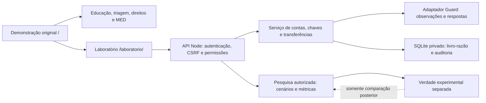

# JUSTEC — entrega técnica do laboratório multiusuário

Versão local 1.0.0, 22/10/2026. Implementação acadêmica com dinheiro exclusivamente virtual. Os dois DOCX e o pedido principal foram lidos; a autorização direta de implementação prevalece sobre a indicação de “proposta” nos anexos. Aprovação do escopo não foi tratada como validação científica, conformidade regulatória ou autorização ética para pesquisa com pessoas.

## 1. Arquitetura e migração incremental

A interface original não foi reescrita nem recebeu saldos persistentes ficticiamente via localStorage. A área nova tem identidade visual compatível, autenticação real e processamento no servidor. Os registros ilustrativos de `statementScenario` não foram convertidos automaticamente em contas de participantes.

`server/index.cjs` inicia HTTP e abre SQLite. Não há dependências de execução: Node.js 24, módulos nativos `http`, `crypto`, `sqlite` e arquivos estáticos. Playwright é dependência exclusivamente de desenvolvimento. `server/http.cjs` só serve arquivos públicos expressamente permitidos, nunca diretório do banco, `.env`, código do servidor ou relatórios.

Arquivos:

- `server/db.cjs`, `migrations/*.sql`: migração, bloqueio, transação e imutabilidade.
- `server/security.cjs`: autenticação, validação e utilidades criptográficas.
- `server/lab.cjs`: sessões, membros, contas, chaves, drafts, avaliações, transferências, extratos e revisões.
- `server/guard.cjs`, `profiles.cjs`: adaptação observável, modos, configurações e perfis públicos.
- `server/research.cjs`: estados-base, cenários, execuções, verdade experimental, métricas e exportação.
- `server/bootstrap.cjs`, `backup.cjs`, `run-regressions.cjs`: operação e testes.
- `laboratorio/index.html`, `app.js`, `lab.css`: interface participante/pesquisa.
- `js/entry.js`: usa `navigateTo` existente para os links educativos do laboratório.

Na demonstração, as únicas adaptações de lógica foram a entrada educativa e um parâmetro opcional do coletor de evidências para limiares do laboratório; seus padrões permanecem iguais. `js/state.js`, `js/transactions.js`, `js/risk.js`, `js/pix.js`, a máquina Pix 2.0 e `js/guard/*` foram preservados. O acesso ao laboratório usa classe própria, evitando ambiguidade do seletor do extrato.

O runtime Tailwind que já era executado de um CDN foi fixado localmente na versão 3.4.17, com licença e SHA-256 em `js/vendor/README.md`. Isso evita executar JavaScript remoto no mesmo servidor da autenticação. A página do laboratório usa somente scripts/estilos locais e CSP restritiva. CSS/fontes externos continuam apenas na demonstração original; os testes dessas fontes não constituem validação dos portais institucionais.

## 2. Modelo de dados

| Entidade | Contrato |
| --- | --- |
| users / auth_sessions | Pseudônimo, derivação de senha, reconhecimento acadêmico versionado; sessão opaca, hash do token, CSRF e expiração. |
| sessions / memberships / invitations | Criador, estado, configuração/versionamento, vínculos, papel, responsáveis pela sessão e convite de uso único. |
| accounts / pix_keys | Sessão, proprietário, perfil público, estado e limite; chave sintética, versão e histórico de desativação. |
| drafts / evaluations | Contrato conferido, ator/origem/destino, valor, versão de chave/política, respostas, pausa e decisão explicável por fase. |
| transfers / ledger_entries | Operação e duas partidas vinculadas, valor inteiro, tipo e idempotência. Saldo deriva da soma dos lançamentos. |
| reviews / review_decisions | Pedido e decisão posterior, sem apagar avaliação original. |
| scenarios / ground_truth | Estado-base público ao pesquisador e rótulos secretos em tabela separada. |
| runs / run_operations | Nova sessão de execução, contas/participantes, condição, hash da base, configuração original e operações previstas. |
| snapshots / account_observations / attempt_observations | Restauração em novo ambiente, mantendo proveniência de fatos anteriores sem duplicar débitos. |
| observations / participant_feedback / audit_events | Anotações de pesquisa, autorrelato opcional e trilha de eventos imutável pela aplicação. |

Migrações versionadas:

1. `001_laboratory.sql`: fundação, permissões, contas, operações, pesquisa e auditoria.
2. `002_participant_feedback.sql`: autorrelato opcional.
3. `003_draft_revisions.sql`: cadeia de reconsiderações e contrato imutável da operação.

Migrações são verificadas sob `BEGIN IMMEDIATE`; o teste de inicialização concorrente confirma uma aplicação por versão. Nunca se deve editar uma migração já distribuída: criar a próxima versão. A imutabilidade via triggers protege livro-razão, transferências, avaliações, gabaritos, decisões de revisão, anotações e auditoria contra alterações pela aplicação. Não é proteção criptográfica contra um administrador que controla o arquivo SQLite ou o sistema operacional.

## 3. Permissões

| Ação | Participante | Pesquisador na sessão | Administrador na sessão |
| --- | --- | --- | --- |
| Ler/operar suas contas | Sim | Sim | Sim |
| Transferir da conta privada de outro titular | Não | Não | Não |
| Resolver chave da mesma sessão sem ver saldo de terceiros | Sim | Sim | Sim |
| Acessar outra sessão sem vínculo | Não | Não | Não |
| Ler contas, auditoria, cenários e métricas autorizadas | Não | Sim | Sim |
| Criar cenários, execuções, snapshots e decidir revisões | Não | Sim | Sim |
| Configurar perfil/limite/restrição com fundamento | Não | Sim | Sim |
| Convidar, atribuir papéis, alterar política ou aportar valores | Não | Não | Sim |

O administrador inicial global só é criado por CLI com credencial exclusiva. Apenas ele cria uma sessão principal. O criador recebe papel administrativo nessa sessão; a equipe entra por convite explícito. Papéis são verificados no banco em cada requisição. Um administrador de uma sessão não recebe acesso automático a outra. Um pesquisador pode administrar o novo ambiente de execução que cria, sem ganhar acesso a contas privadas como origem de transferências.

O cadastro público não aceita papel administrativo. Convites têm 32 bytes aleatórios, hash no banco, expiram em 72 horas e são usados uma vez. O último administrador não pode ser removido por alteração de papel. Uma pessoa pode acumular capacidades por herança de papel e possuir papéis diferentes em sessões diferentes; não há troca de identidade ou titularidade para executar pagamentos de terceiros.

## 4. Autenticação, privacidade e segurança

- Pseudônimo de 3–32 caracteres, sem e-mail, CPF ou telefone de identificação.
- Senha exclusiva de 12–128 caracteres, salt aleatório e scrypt N=16384/r=8/p=1, derivação de 64 bytes. Sem senha padrão ou armazenamento em texto puro.
- Token opaco de 32 bytes; somente SHA-256 armazenado. Cookie HttpOnly, SameSite=Strict, Max-Age de oito horas e Secure sob origem HTTPS configurada.
- Mutações requerem JSON, origem exata e token CSRF; login/cadastro usam validação de origem e JSON antes da autenticação.
- Validação de propriedade, sessão, perfil, centavos e tipos; SQL parametrizado e renderização com textContent.
- Corpo limitado a 128 KiB, timeouts HTTP e limitação de tentativas por IP/processo. Esse rate limit não é um serviço distribuído e reinicia com o processo.
- CSP do laboratório sem scripts inline ou origens de terceiros; proteção de frame e MIME. Sem credenciais em páginas ou código público.
- Caminho de banco fora da raiz pública por padrão; arquivos privados e backup sem sobrescrita. Os segredos necessários ao bootstrap não são impressos.

Auditoria registra criação, convites, chaves, alocações, configurações, fases do Guard, decisões, autorização, reconsideração, revisões, observações e exportação. Recusas/falhas HTTP autenticadas são registradas sem senha, código demonstrativo ou token de acesso. Não há alteração de resultado por participante. A interface pede somente dados sintéticos; isso não é um filtro infalível contra alguém digitar um nome real. O reconhecimento acadêmico do cadastro não substitui TCLE, aprovação ética ou política de retenção para estudo com pessoas.

## 5. Sessões, contas e chaves

Sessões ficam ativas, arquivadas ou encerradas. Arquivar mantém consultas e bloqueia novas operações financeiras; encerramento não reabre silenciosamente. Cada participante cria até o limite da sessão e alterna suas contas. Saldo inicial vem da política, não do formulário cliente. Pessoa física, pessoa jurídica, conta nova e perfil consolidado são os padrões; a equipe pode acrescentar códigos de perfil público na configuração. Perfis em uso não podem ser removidos. O perfil não fornece o rótulo secreto ao Guard nem inventa histórico.

Chaves geradas têm formato `sim-<identificador>@pix.justec.invalid`. Não são aceitos CPF, telefone ou e-mail reais para cadastramento. A unicidade é por sessão; consulta é restrita a membro e devolve somente dados necessários do recebedor, sem saldo ou proprietário privado. Rotação/desativação incrementa versão e preserva o registro antigo. Mudança durante a jornada invalida a autorização. Os quatro destinatários fixos da demonstração não são usados pelo laboratório.

## 6. Motor financeiro

O cliente transmite centavos inteiros. Valores devem ser seguros, positivos, até 1.000.000.000 centavos por valor validado; limites operacionais por conta são verificados adicionalmente. Padrões: alocação de R$ 2.480,50, máximo de cinco contas por participante e limite de R$ 2.000 por Pix, todos configuráveis por administrador. Um aporte administrativo é explícito, com justificativa, nunca confundido com Pix.

Fluxo no servidor:

1. Autenticar e verificar vínculo, titularidade e sessão ativa.
2. Resolver a chave dentro da sessão, confirmar contas distintas e operacionais.
3. Validar valor, limite e saldo pelo livro-razão.
4. Criar contrato de conferência com versão de chave/política e expiração de 15 minutos.
5. Avaliar Guard e, se necessário, colher respostas/reconhecimento do alerta.
6. Armazenar início e fim da pausa; o cliente não pode antecipar o relógio servidor.
7. Verificar código 0000 e revalidar toda a operação, inclusive restrições/saldo/política.
8. Em `BEGIN IMMEDIATE`, registrar transferência e duas partidas opostas, checar soma zero e confirmar o commit.
9. Só então devolver comprovante e atualizar os dois extratos.

A tesouraria virtual é a contraparte interna de alocações/ajustes/restaurações. Pode ter saldo negativo; contas de participantes não. Tipos: `pix`, `allocation`, `adjustment`, `scenario_history`, `restoration`. Cada tipo mantém duas partidas; transferências conservam a soma entre contas. O extrato oferece filtros de período, tipo, situação e conta; tentativas bloqueadas/reconsideradas ficam separadas dos lançamentos.

Idempotência liga sessão, ator, chave e operação; repetir autorização retorna o mesmo comprovante. Reutilizar a chave em outra operação é conflito. Um segundo clique não faz outro débito. Duas operações simultâneas disputam o bloqueio de escrita e o saldo é recalculado dentro da transação. Foi testado com conexões em workers independentes e também por HTTP concorrente.

Uma exceção entre as duas partidas reverte transferência, débito, crédito e estado de sucesso. O teste injeta erro de escrita no crédito e verifica rollback integral, além de retorno HTTP de falha. Não se usa sucesso meramente visual nem compensação posterior como substituto da atomicidade.

## 7. Guard em três camadas

A camada educativa permanece independente do Pix. A contextual usa identidade, pressão/urgência, pagamento antecipado e instruções para ignorar alertas. A comportamental recebe apenas fatos disponíveis: relacionamentos de Pix concluídos, amostra de valores, tentativas interrompidas e restrições operacionais. Não há reputação, denúncias, dispositivo ou consultas externas inventadas.

O laboratório reutiliza `collectPixEvidence`, `evaluatePixEvidence`, `decidePixPolicy` e a biblioteca de mensagens da jornada atual. Os pesos iniciais são obtidos de `riskRules`, sem passar os destinatários/flags estáticos ao motor persistente. A referência fixa ilustrativa de R$ 1.000 da demonstração não é usada como se fosse histórico real do participante: o valor atípico exige amostra suficiente do livro-razão. `js/guard` ESM continua como motor experimental independente, sem mistura automática de decisões.

Defaults ajustáveis: destinatário novo 20, valor atípico 25, repetição 15, alterações observadas 20, moderado 30 e alto 60; amostra mínima 3, valor atípico acima de 3 vezes a média. Alterar valor/origem/destino cancela a conferência; novas conferências iguais após reconsideração geram revisão vinculada. Na primeira versão persistente não se calcula uma pontuação comportamental de edição livre de valor: contratos são imutáveis e os eventos de revisão são auditados. Não se apresenta esse sinal como observado quando não é coletado.

Os resultados separam evidência/origem/disponibilidade, pontuação heurística, regra, classificação, ação e justificativa. Versionamento inclui versão do adaptador e hash dos limiares. Rótulos `legitimate`/`fraudulent` só existem na pesquisa, para comparação posterior.

Ações: ALLOWED, NEEDS_VERIFICATION, INCONCLUSIVE e BLOCKED. Destinatário novo isolado não comprova fraude. Sinais contextuais combinados podem interromper a operação sem restringir automaticamente o recebedor. Respostas “Não sei” não viram segurança. A condição comportamental solicita somente reconhecimento de alerta, sem misturar perguntas contextuais. Restrição operacional ativa continua sendo respeitada em qualquer condição.

Revisões preservam a decisão original. Só pesquisador/administrador pode decidir; liberação manual cria nova conferência vinculada e identificada como manual, com pausa/revalidação próprias. Ela não ignora saldo, propriedade, sessão ou restrição operacional da conta. O gabarito experimental nunca aprova automaticamente um suposto falso positivo.

## 8. Condições e reprodutibilidade

| Condição | Durante a operação |
| --- | --- |
| none | Sem intervenção adicional, além de autenticação/invariantes/restrições operacionais. |
| education | Orientação/pausa educativa, sem usar sinais contextuais ou comportamentais para intervenção adicional. |
| context | Educação e perguntas após solicitação explícita ou evidência observável; sem pontuação comportamental. |
| behavior | Análise comportamental e reconhecimento proporcional; perguntas contextuais desativadas, sem pausa adicional. |
| integrated | Educação, contexto e comportamento, com pausa configurada. |

A educação da página inicial permanece comum a todas as condições, por decisão do grupo. Portanto `none` não representa ausência absoluta de acesso à educação: significa ausência de intervenção adicional na jornada. Duração zero pode ser configurada experimentalmente; não se afirma que cinco segundos ou qualquer outra duração tenham eficácia demonstrada.

Cenários registram contas, perfis, limites, alocações, histórico sintético explicitamente identificado e operações. O rótulo é separado antes de persistir o estado-base; não chega à função de avaliação. A verdade experimental é acessível somente ao pesquisador autorizado.

Respostas previstas no roteiro não são lidas para ativar a intervenção ao criar uma tarefa. O participante solicita explicitamente a verificação; o motor só recebe respostas efetivamente fornecidas. A opção de executar roteiro do pesquisador solicita contexto expressamente. Um teste com os quatro exemplos confirma que scripts/rótulos diferentes, sem respostas fornecidas, não antecipam o resultado.

Cada execução cria nova sessão e contas, tesouraria/livro-razão e chaves próprias. A base e as configurações recebem hashes; vínculos de titulares também compõem a equivalência. Uma repetição usa a política original, mesmo que o pai tenha sido reconfigurado. Não se pode editar a política de uma execução existente; cria-se outra condição. Alterações administrativas operacionais são auditadas e devem ser consideradas pelo pesquisador antes de comparar resultados.

Snapshots capturam saldos, membros, contas, chaves, histórico observável e configurações. Restaurar cria nova sessão e lançamentos do tipo restoration; o histórico anterior vira observação com proveniência, sem aplicar o débito antigo novamente. Não há exclusão de execuções anteriores. Arquivar o original é uma opção administrativa explícita.

Reconsiderações com nova conferência preservam uma cadeia de revisões e o vínculo do ensaio. A matriz pode reconhecer a conclusão posterior sem apagar a desistência anterior; o tempo inclui a cadeia. A revisão manual de uma interrupção não transforma retroativamente um falso positivo em acerto do algoritmo. Edições livres que mudam o contrato exigem nova operação; não são declaradas automaticamente como o mesmo ensaio-base.

## 9. Métricas, auditoria e exportação

A definição atual de positivo é **operação interrompida**, e não mera exibição de alerta. Apenas concluídas/interrompidas entram na matriz; pendentes/canceladas são separadas. Há VP, FP, VN, FN, sensibilidade observada, taxa de bloqueio indevido e tempo médio, com denominadores explícitos. Divisão por zero retorna null/“Sem dados”, nunca 0% ou 100% inventados. Agrupamento exige mesma base/vínculos e configuração. Não há inferência estatística, intervalos de confiança ou alegação de eficácia de mercado.

Os quatro exemplos permitem observar os quatro quadrantes: fraude com sinais, operação legítima, falso positivo contextual e fraude sem indícios disponíveis. Os testes demonstram decisão igual para evidências iguais com rótulos opostos. Isso é teste de software, não um resultado de pesquisa com consumidores.

Alertas/códigos são distribuídos por avaliação, incluindo fases repetidas — a UI informa a unidade. Reconsiderações, revisões, decisões e anotações permanecem auditadas. O participante pode fornecer autorrelato opcional e imutável de compreensão/intenção; isso não é teste validado de compreensão e não condiciona o Pix.

JSON exporta sessão, configurações, contas, operações, avaliações, revisões, auditoria, cenários e execuções autorizadas. CSV apresenta os resultados experimentais, protegendo células textuais contra fórmulas. Senhas, hashes de autenticação, cookies e convites não são exportados. Exportações são restritas e auditadas. A lista pública de tarefas de um participante não traz o gabarito nem as respostas de roteiro; somente pesquisadores veem esses dados. Operações atribuídas a outro titular não podem ser executadas pelo pesquisador em seu lugar.

## 10. API resumida

Todos os caminhos abaixo usam `/api`; salvo health/login/cadastro, exigem cookie autenticado. Mutações exigem Origin, JSON e X-CSRF-Token. Autorização também exige Idempotency-Key.

| Grupo | Rotas e finalidade |
| --- | --- |
| Acesso | GET health/auth/me; POST auth/register, auth/login, auth/logout. |
| Sessões | GET/POST sessions; GET/PATCH sessions/:id; POST join; membros/convites sob sessions/:id. |
| Contas/chaves | GET/POST sessions/:id/accounts; GET/PATCH accounts/:id; POST accounts/:id/keys e allocation; PATCH/DELETE keys/:id. |
| Consulta | POST sessions/:id/lookup; GET accounts/:id/statement; GET transfers/:id; GET evaluations/:id. |
| Jornada | POST/GET sessions/:id/drafts; GET drafts/:id; POST drafts/:id/evaluate, authorize, cancel, revise, reviews, feedback. |
| Revisão | GET sessions/:id/reviews; POST reviews/:id/resolve e followup. |
| Pesquisa | GET/POST sessions/:id/scenarios; POST sessions/:id/scenarios/:scenario/runs; GET sessions/:id/runs; POST runs/:id/repeat. |
| Tarefas | GET sessions/:id/tasks; POST tasks/:id/draft (apenas titular). |
| Estado-base | GET/POST sessions/:id/snapshots; POST snapshots/:id/restore. |
| Painel | GET sessions/:id/research; GET sessions/:id/examples; GET sessions/:id/export?format=json|csv; POST sessions/:id/observations. |

A linha de consulta abre duas rotas independentes: `/transfers/:id` e `/evaluations/:id`. A linha do painel também abre caminhos separados: `/sessions/:id/research`, `/sessions/:id/examples` e `/sessions/:id/export?format=json|csv`.

Erros são estruturados como `{error:{code,message}}`; 400 validação, 401 autenticação, 403 permissão/CSRF/origem, 404 inexistência autorizada, 409 conflito/estado/saldo/pausa, 413 corpo grande, 429 limite e 500 falha interna sem confirmação financeira. Não se retornam stack traces ou credenciais.

## 11. Instalação, operação e entrega

Instruções executáveis de bootstrap, login, convites, backup e testes estão no README da raiz. Os bancos dos testes são temporários; não foi criado administrador com senha padrão nem banco de participantes reais. O bootstrap exige credencial fornecida localmente pelo operador. Sem login de participantes inventado ou acesso público ao banco.

SQLite usa WAL, foreign keys, FULL synchronous e busy_timeout de dez segundos. A arquitetura é adequada a laboratório pequeno em um servidor com disco persistente; operações síncronas e consultas de soma não são uma plataforma de pagamentos de alta escala. Há backup consistente testado e restauração controlada de cenários. Backup de produção e recuperação devem ser praticados pela equipe antes de estudo com pessoas.

A publicação atual na Vercel é estática. Não foi substituída por um laboratório que alegasse persistência em disco efêmero. É necessário escolher/configurar hospedagem Node com volume e TLS, ou implementar posteriormente adaptador PostgreSQL e funções apropriadas. A entrega local inicial não incluiu publicação. Na etapa seguinte, autorizada pelo titular, a versão anterior foi preservada e o laboratório separado em branch própria para envio ao GitHub, com blueprint Render e documentos de apresentação. Não houve implantação Render/Vercel nem contratação de infraestrutura; ver deploy/README.md e o novo registro do Relatório-Mestre.

## 12. Validação e pendências

Resultados finais e etapas estão registrados no Relatório-Mestre. Foram exercitados autenticação, permissão, isolamento, chaves, transação bilateral, simultaneidade em conexões independentes, idempotência, rollback, pausa no servidor, revisões, experimentos, métricas, persistência após reinício, migrações e backup; também navegador com múltiplos participantes e sete larguras.

Pendências que não devem ser tratadas como implementadas: hospedagem pública persistente; PostgreSQL/serverless; recuperação de senha/MFA/identidade institucional; limitação distribuída; testes de carga e auditoria independente; estudo de usabilidade e eficácia; leitor de tela/dispositivos físicos/Safari/Firefox; TCLE/retenção aplicáveis ao estudo real; verificação externa dos portais institucionais já sinalizada na orientação educativa. QR Code, Copia e Cola e integrações bancárias reais não foram introduzidos.
